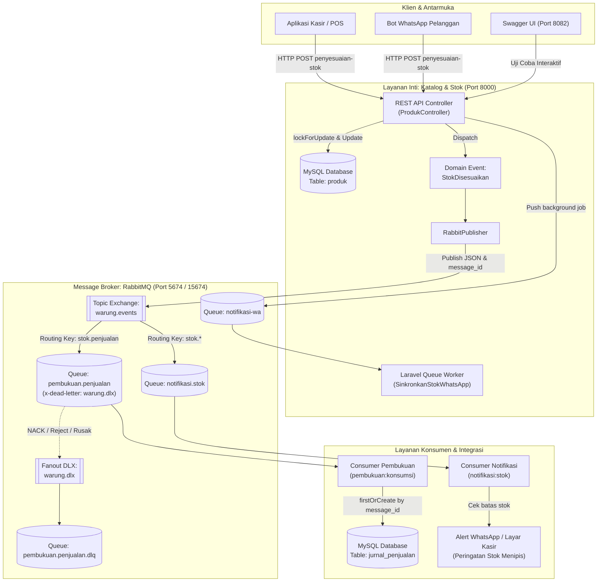
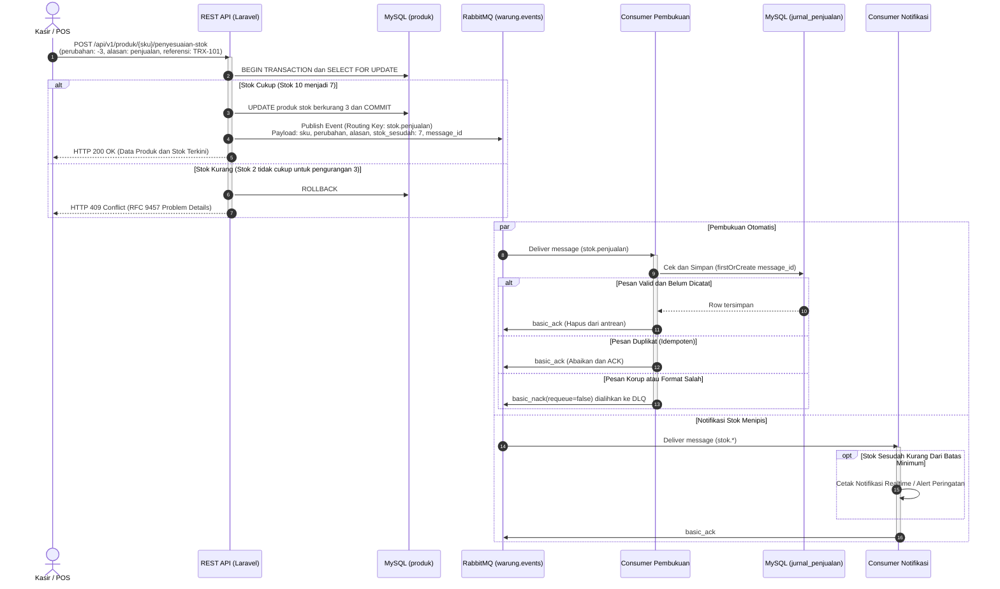
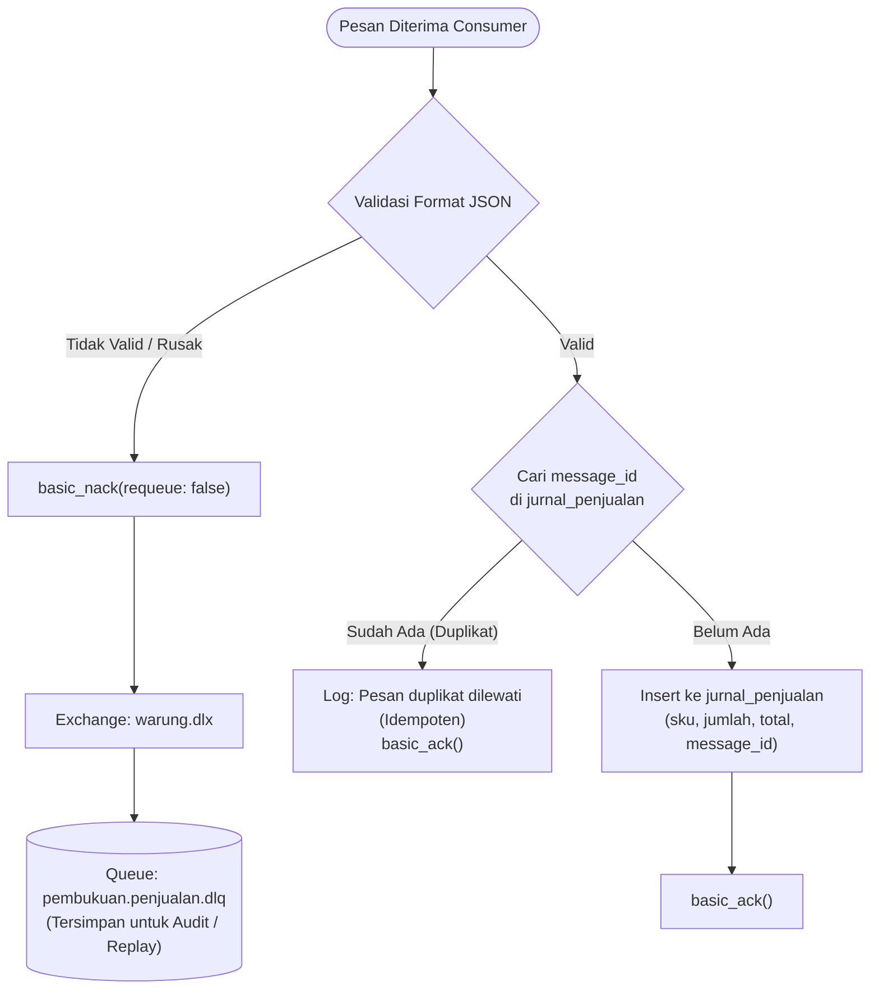

# Layanan Katalog, Stok, dan Pembukuan — Warung Ibu Beti

**Mata Kuliah:** Integrasi Sistem dan Komputasi Awan (25IF1504)  
**Institusi:** STMIK Bandung  
**Kelompok:** Intel  

### Anggota Kelompok:
1. **Jacky Firmansah** (1224010)
2. **Arya Kusuma Dinata** (1224005)
3. **Mochamad Aldi Ardiansyah** (1224020)
4. **Andhi Yudha Permana** (1224017)

---

## 📌 Ringkasan Sistem

Repositori ini mengimplementasikan sistem backend terintegrasi untuk **Warung Ibu Beti** dengan dua gaya integrasi utama:
1. **Remote Procedure Invocation (REST API Level 2)** sesuai Modul Praktikum 1:
   - Desain API-first dengan spesifikasi **OpenAPI 3.1.0** (tervalidasi bersih 0 error di Spectral).
   - Penanganan error standar **RFC 9457 Problem Details** (`application/problem+json`).
   - Kontrol konkurensi stok menggunakan transaksi database ACID dan *pessimistic row-locking* (`SELECT ... FOR UPDATE`).
2. **Asynchronous Messaging & Background Processing (RabbitMQ & Laravel Queue)** sesuai Modul Praktikum 2:
   - Pola Publish-Subscribe berbasis Domain Event `StokDisesuaikan`.
   - Topic Exchange `warung.events` dengan dynamic routing keys (`stok.penjualan`, `stok.restok`, `stok.koreksi`).
   - Consumer Idempoten (`pembukuan:konsumsi`) yang mencatat mutasi ke tabel `jurnal_penjualan` menggunakan `message_id` unik (`firstOrCreate`).
   - Penanganan kegagalan pesan menggunakan **Dead Letter Exchange (DLQ)** `warung.dlx` dengan `x-dead-letter-exchange`.
   - Consumer Notifikasi Realtime (`notifikasi:stok`) dengan filter batas minimum stok (*low stock threshold*).
   - Background Job asynchronous (`SinkronkanStokWhatsApp`) melalui Laravel Queue driver RabbitMQ pada antrean `notifikasi-wa`.

---

## 🏗️ 1. Diagram Arsitektur & Topologi Sistem

Arsitektur sistem memisahkan proses transaksi kasir yang sinkron dengan proses analitik/pembukuan dan notifikasi yang asinkron:



---

## 🔄 2. Diagram Alur Transaksi & Messaging (Sequence Diagram)

Diagram berikut mengilustrasikan siklus lengkap dari kasir melakukan transaksi hingga pencatatan pembukuan dan deteksi stok menipis:



---

## 🎯 3. Alur Idempotensi & Dead Letter Queue (DLQ)



---

## 📋 4. Tabel Kontrak Event RabbitMQ

| Nama Event | Exchange / Routing Key | Payload (Field & Tipe) | Penerbit | Penerima |
|---|---|---|---|---|
| `StokDisesuaikan` | `warung.events`<br>• `stok.penjualan`<br>• `stok.restok`<br>• `stok.koreksi` | `sku` (string)<br>`perubahan` (int)<br>`alasan` (string)<br>`stok_sesudah` (int)<br>`harga` (int)<br>`terjadi_pada` (ISO 8601 string)<br>`message_id` (UUID v4) | Layanan Katalog & Stok | 1. Consumer Pembukuan (`pembukuan.penjualan`)<br>2. Consumer Notifikasi (`notifikasi.stok`) |

> **Mengapa alur ini lebih tepat asinkron daripada panggilan REST langsung antar service?**  
> Penyesuaian stok harus merespons transaksi kasir dan bot WhatsApp secepat mungkin (< 50ms) tanpa dibebani keterlambatan sistem pembukuan atau pengiriman pesan WhatsApp. Jika sistem pembukuan lambat atau sedang maintenance, kasir tetap dapat melayani pelanggan tanpa gangguan (*loose coupling & high availability*).

---

## 🔌 5. Pemetaan Port & Layanan Docker

| Layanan | Container Name | Port Host | Keterangan & Akses |
|---|---|---|---|
| **REST API (Laravel)** | `warung-ibu-beti-laravel.test-1` | `8000` | Endpoint: `http://localhost:8000/api/v1` |
| **Swagger UI** | `warung-ibu-beti-swagger-ui-1` | `8082` | Dokumentasi Interaktif: `http://localhost:8082` |
| **RabbitMQ Management** | `warung-ibu-beti-rabbitmq-1` | `15674` | Dashboard: `http://localhost:15674` (`guest`/`guest`) |
| **RabbitMQ AMQP** | `warung-ibu-beti-rabbitmq-1` | `5674` | Protokol pesan AMQP 0-9-1 |
| **MySQL Database** | `warung-ibu-beti-mysql-1` | `3308` | Database: `warung_ibu_beti` (`sail`/`password`) |

---

## 🚀 6. Panduan Instalasi & Menjalankan Proyek

### Prasyarat
- Docker Desktop & Docker Compose
- WSL 2 (Ubuntu) / Linux Environment
- Git

### Langkah Menjalankan:
1. **Clone repositori**:
   ```bash
   git clone <URL_REPOSITORY_GITHUB>
   cd warung-ibu-beti
   ```

2. **Salin Environment**:
   ```bash
   cp .env.example .env
   ```

3. **Jalankan Container Docker via Laravel Sail**:
   ```bash
   ./vendor/bin/sail up -d
   ```

4. **Jalankan Migrasi Database**:
   ```bash
   ./vendor/bin/sail artisan migrate
   ```

5. **Inisialisasi Topologi RabbitMQ**:
   ```bash
   ./vendor/bin/sail artisan warung:topologi
   ```
   *Perintah ini akan mendeklarasikan exchange `warung.events`, `warung.dlx`, antrean, dan binding secara otomatis.*

6. **Menjalankan Consumer Pembukuan (Terminal 1)**:
   ```bash
   ./vendor/bin/sail artisan pembukuan:konsumsi
   ```

7. **Menjalankan Consumer Notifikasi Stok Menipis (Terminal 2)**:
   ```bash
   ./vendor/bin/sail artisan notifikasi:stok --batas=5
   ```

8. **Menjalankan Laravel Queue Worker (Terminal 3)**:
   ```bash
   ./vendor/bin/sail artisan queue:work rabbitmq --queue=notifikasi-wa
   ```

---

## 🧪 7. Pengujian Otomatis

### A. Menjalankan Unit & Feature Test (PHPUnit)
Semua skenario pengujian REST API, validasi RFC 9457, penyesuaian stok, pengiriman event RabbitMQ, dan idempotensi pembukuan telah diotomatisasi:
```bash
./vendor/bin/sail artisan test
```
*Status: **17 tests passed (52 assertions)**.*

### B. Validasi Kontrak OpenAPI dengan Spectral
Linter otomatis untuk memastikan kepatuhan spesifikasi OpenAPI 3.1.0:
```bash
npx spectral lint openapi.yaml
```
*Status: **0 errors / 0 warnings**.*

---

## 👥 Kontribusi Kelompok Intel
- **Modul 1 (REST API & OpenAPI):** Perancangan kontrak `openapi.yaml`, validasi Spectral, implementasi endpoint katalog & penyesuaian stok berstatus atomik (`lockForUpdate`), serta penanganan RFC 9457 Problem Details.
- **Modul 2 (Asynchronous Messaging):** Konfigurasi RabbitMQ (Topic Exchange, DLQ, Queue Bindings), Domain Event `StokDisesuaikan`, Consumer Pembukuan Idempoten (`jurnal_penjualan`), Notifikasi Realtime batas stok, dan Background Queue Worker WhatsApp.
