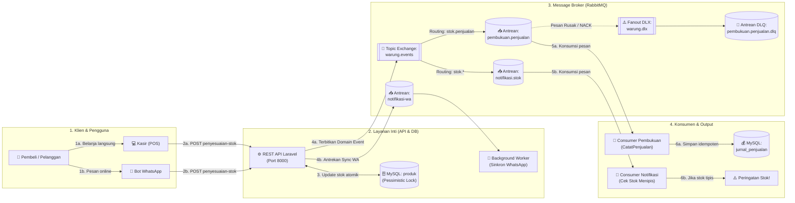
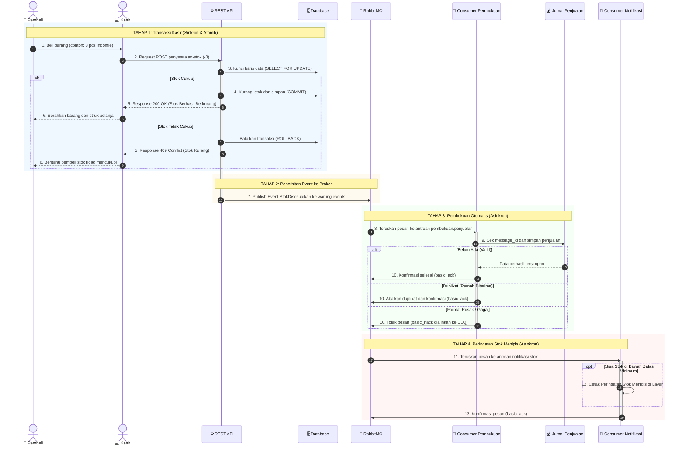
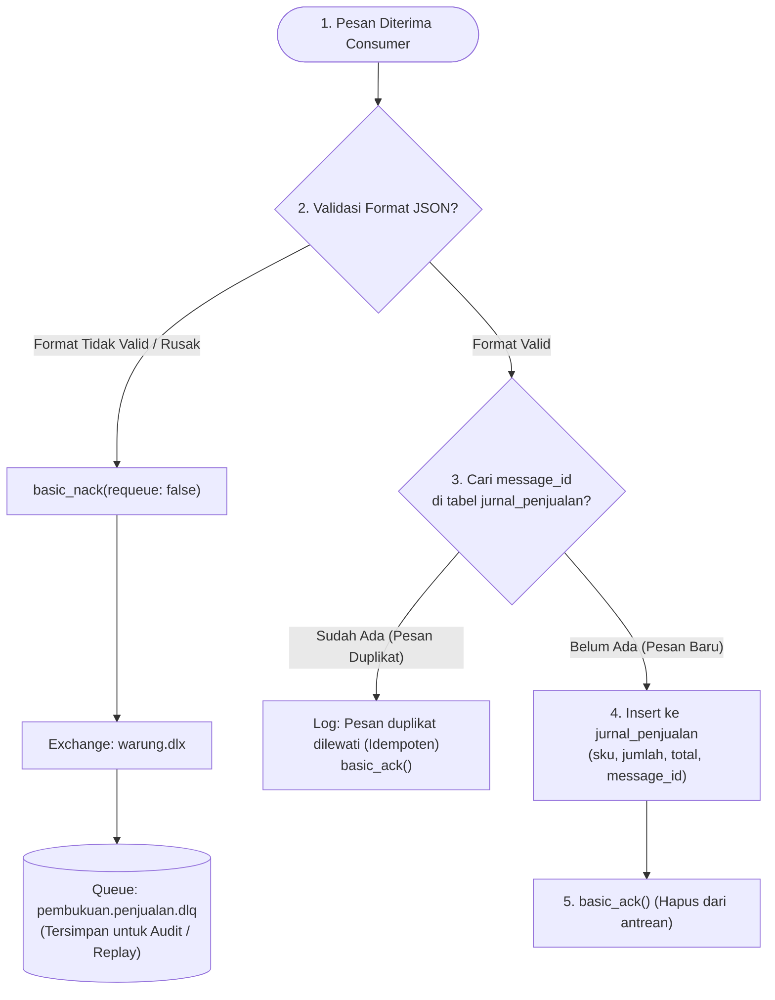

# Layanan Katalog, Stok, dan Pembukuan — Warung Ibu Beti

**Mata Kuliah:** Integrasi Sistem dan Komputasi Awan (25IF1504)  
**Institusi:** STMIK Bandung  
**Kelompok:** Intel  

### Anggota Kelompok:
1. **Jacky Firmansah** (1224010)
2. **Arya Kusuma Dinata** (1224005)
3. **Mochamad Aldi Ardiansyah** (1224020)
4. **Andhi Yudha Permana** (1224017)

---

## 📌 Ringkasan Sistem

Repositori ini mengimplementasikan sistem backend terintegrasi untuk **Warung Ibu Beti** dengan dua gaya integrasi utama:
1. **Remote Procedure Invocation (REST API Level 2)** sesuai Modul Praktikum 1:
   - Desain API-first dengan spesifikasi **OpenAPI 3.1.0** (tervalidasi bersih 0 error di Spectral).
   - Penanganan error standar **RFC 9457 Problem Details** (`application/problem+json`).
   - Kontrol konkurensi stok menggunakan transaksi database ACID dan *pessimistic row-locking* (`SELECT ... FOR UPDATE`).
2. **Asynchronous Messaging & Background Processing (RabbitMQ & Laravel Queue)** sesuai Modul Praktikum 2:
   - Pola Publish-Subscribe berbasis Domain Event `StokDisesuaikan`.
   - Topic Exchange `warung.events` dengan dynamic routing keys (`stok.penjualan`, `stok.restok`, `stok.koreksi`).
   - Consumer Idempoten (`pembukuan:konsumsi`) yang mencatat mutasi ke tabel `jurnal_penjualan` menggunakan `message_id` unik (`firstOrCreate`).
   - Penanganan kegagalan pesan menggunakan **Dead Letter Exchange (DLQ)** `warung.dlx` dengan `x-dead-letter-exchange`.
   - Consumer Notifikasi Realtime (`notifikasi:stok`) dengan filter batas minimum stok (*low stock threshold*).
   - Background Job asynchronous (`SinkronkanStokWhatsApp`) melalui Laravel Queue driver RabbitMQ pada antrean `notifikasi-wa`.

---

## 🏗️ 1. Diagram Arsitektur & Topologi Sistem

Alur arsitektur sistem disusun berurutan dari kiri ke kanan (**Klien $\rightarrow$ API $\rightarrow$ RabbitMQ Broker $\rightarrow$ Konsumen & Pembukuan**) agar arah dan tujuannya sangat mudah dipahami:



---

## 🔄 2. Diagram Alur Transaksi & Messaging (Sequence Diagram)

Diagram berikut membagi alur transaksi menjadi **4 Tahapan Jelas** dengan penomoran urut langkah:



---

## 🎯 3. Alur Idempotensi & Dead Letter Queue (DLQ)



---

## 📋 4. Kontrak REST API (Modul Praktikum 1 — Bagian B)

Sesuai tuntutan **Modul Praktikum 1 (Bab 9 Bagian B)**, layanan backend Warung Ibu Beti mengimplementasikan gaya *Remote Procedure Invocation* (REST API Level 2) dengan spesifikasi OpenAPI 3.1.0 dan respons galat standar RFC 9457 Problem Details:

**Nama Layanan:** Layanan Katalog dan Stok Sembako — Warung Ibu Beti

| Operasi | Method dan Path | Isi Permintaan (Field Wajib) | Status Berhasil | Galat yang Dijanjikan |
|---|---|---|---|---|
| **Daftar Sembako** | `GET /api/v1/produk` | *(Tanpa request body)* | `200 OK` | — |
| **Tambah Produk Sembako** | `POST /api/v1/produk` | `sku` (string, misal `BRG-001`), `nama` (string, max 120), `harga` (integer, min: 0). Opsional: `stok` (default 0) | `201 Created` + `Location` | `422 Unprocessable Content` |
| **Detail Produk** | `GET /api/v1/produk/{sku}` | *(Parameter URL SKU)* | `200 OK` | `404 Not Found` |
| **Penyesuaian Stok** | `POST /api/v1/produk/{sku}/penyesuaian-stok` | `perubahan` (integer, bukan 0: negatif = penjualan/keluar, positif = restok/masuk), `alasan` (`penjualan`, `restok`, `koreksi`) | `200 OK` | `404 Not Found`, `409 Conflict`, `422 Unprocessable Content` |

### ⚠️ Aturan Bisnis Galat 4xx Selain 422:
- **Status Code:** `409 Conflict` (Format: `application/problem+json`).
- **Penyebab & Alasan:** Penjualan barang sembako (seperti beras atau minyak goreng) di kasir POS atau pemesanan via Bot WhatsApp tidak boleh menyebabkan stok fisik di warung bernilai negatif. Ketika kasir atau bot meminta pengurangan stok yang jumlahnya melebihi sisa persediaan aktual di rak warung, sistem melempar domain exception `StokTidakCukup`.
- **Transaksional & Lock:** Pembaruan stok dilindungi transaksi database ACID dengan *pessimistic row locking* (`SELECT ... FOR UPDATE`), sehingga jika terjadi konflik stok tidak cukup, perubahan dibatalkan (*rollback* otomatis) dan sistem mengembalikan Problem Details 409 yang menginfokan sisa `stok_tersedia` saat ini.

---

## 📢 5. Kontrak Event Asynchronous RabbitMQ (Modul Praktikum 2 — Bagian B)

Sesuai tuntutan **Modul Praktikum 2 (Bab 9 Bagian B)**, integrasi antarlayanan Warung Ibu Beti menggunakan perantara pesan (*message broker*) RabbitMQ:

| Nama Event | Exchange / Routing Key | Field & Tipe Payload | Penerbit | Penerima |
|---|---|---|---|---|
| `StokDisesuaikan` *(nama bentuk lampau)* | **Exchange:** `warung.events` (Topic, Durable)<br>**Routing Keys:**<br>• `stok.penjualan`<br>• `stok.restok`<br>• `stok.koreksi` | `sku` (string)<br>`perubahan` (int)<br>`alasan` (string)<br>`stok_sesudah` (int)<br>`harga` (int)<br>`terjadi_pada` (ISO 8601 string)<br>`message_id` (UUID v4) | Layanan Katalog & Stok Warung Ibu Beti | 1. **Consumer Pembukuan** (Antrean: `pembukuan.penjualan`)<br>2. **Consumer Notifikasi** (Antrean: `notifikasi.stok`) |

> **Mengapa alur ini lebih tepat asinkron daripada panggilan REST langsung antar service?**  
> 1. **Performa Kasir & Bot WA Cepat:** Penyesuaian stok di kasir warung dan bot WhatsApp harus merespons dalam hitungan milidetik (< 50ms). Jika pencatatan jurnal keuangan atau notifikasi dilakukan via REST sinkron, kasir harus menunggu proses tersebut selesai.
> 2. **Ketahanan Sistem (*Fault Tolerance & Loose Coupling*):** Jika sistem pembukuan sedang *down*, *restart*, atau *maintenance*, kasir Warung Ibu Beti tetap bisa melayani transaksi pelanggan tanpa terputus. Pesan transaksi aman mengantre di broker RabbitMQ (*message buffering*) dan akan diproses secara otomatis saat consumer pembukuan kembali aktif.
> 3. **Ekstensibilitas Layanan (*Publish-Subscribe*):** Layanan baru (seperti sistem notifikasi stok menipis atau analitik belanja) dapat langsung berlangganan event tanpa mengubah sebaris pun kode di controller kasir.

---

## 🔬 6. Bukti Eksekusi Skenario Uji Lapangan (Bab 5, 6, & 7)

Tabel berikut membuktikan bahwa seluruh skenario integrasi asinkron telah diuji secara nyata pada lingkungan Warung Ibu Beti:

### Skenario Uji 1: Point-to-Point dan Consumer Pembukuan yang Mati (Bab 5)
*Membuktikan transaksi penjualan sembako tetap sukses dan tersimpan di broker saat sistem pembukuan tidak aktif.*

| Langkah Pengujian | Hasil yang Diharapkan | Hasil yang Terjadi | Status |
|---|---|---|:---:|
| **Penjualan 1** saat consumer pembukuan menyala (`BRG-001`, terjual 2 pcs) | Terminal consumer menampilkan log `"Dicatat"` | Muncul log `Dicatat : {"sku":"BRG-001",...}` | ✅ Sesuai |
| **Consumer dimatikan (Ctrl+C)**, lalu dilakukan **3x penjualan** berturut-turut | Kolom *Ready* pada antrean `pembukuan.penjualan` di RabbitMQ bernilai **3** | Kolom *Ready* menunjukkan angka **3**, pesan menunggu di buffer | ✅ Sesuai |
| **Respons API Warung** saat consumer pembukuan mati | Tetap mengembalikan HTTP `200 OK` dengan respons cepat (< 40ms) | HTTP 200 OK, stok di database berkurang, transaksi kasir lancar | ✅ Sesuai |
| **Consumer pembukuan dinyalakan kembali** | Tiga pesan diproses berurutan, muncul 3 baris log `"Dicatat"`, *Ready* kembali ke **0** | Ketiga transaksi diproses tuntas, antrean bersih (*Ready = 0*) | ✅ Sesuai |
| **Pemeriksaan Database Jurnal** (`JurnalPenjualan::count()`) | Total tercatat tepat **4 baris jurnal** penjualan | Output tinker menghasilkan nilai `4` baris | ✅ Sesuai |

---

### Skenario Uji 2: Publish-Subscribe Multilayanan (Bab 6)
*Membuktikan satu event dari kasir diterima oleh dua consumer independen (Pembukuan dan Notifikasi).*

| Langkah Pengujian | Hasil yang Diharapkan | Hasil yang Terjadi | Status |
|---|---|---|:---:|
| **Penjualan Beras** (`stok.penjualan`) hingga stok sisa $\le 5$ | • **Pembukuan:** Mencatat jurnal (`"Dicatat"`)<br>• **Notifikasi:** Mencetak peringatan `STOK MENIPIS` | • Terminal Pembukuan: `Dicatat`<br>• Terminal Notifikasi: `STOK MENIPIS - [stok.penjualan] BRG-001 stok sekarang 4` | ✅ Sesuai |
| **Restok Minyak Goreng** (`stok.restok`, +20 pcs) | • **Pembukuan:** Mengabaikan pesan (karena bukan penjualan)<br>• **Notifikasi:** Mencetak update stok normal | • Terminal Pembukuan: Tidak ada output (dilewati)<br>• Terminal Notifikasi: Cetak `[stok.restok] MYK-002 stok sekarang 25` | ✅ Sesuai |
| **Perubahan Kode Warung** untuk menambah layanan notifikasi | **Tidak ada perubahan kode sama sekali** pada layanan inti / kasir | Nol baris kode diubah di controller maupun publisher | ✅ Sesuai |

---

### Skenario Uji 3: Idempotensi Pesan Duplikat & Dead Letter Queue (Bab 7)
*Membuktikan keandalan sistem saat menerima pesan kembar serta pengalihan pesan korup/rusak ke DLQ.*

| Langkah Pengujian | Hasil yang Diharapkan | Hasil yang Terjadi | Status |
|---|---|---|:---:|
| **Pesan Duplikat Pertama** (message_id: `uji-duplikat-1`) | Diproses normal dan dicatat ke jurnal (`"Dicatat"`) | Tercatat ke tabel `jurnal_penjualan` | ✅ Sesuai |
| **Pesan Duplikat Kedua** (message_id sama persis) | Dideteksi sebagai duplikat (`"Dilewati"`), jurnal **tidak bertambah** | Log menampilkan `Dilewati`, baris database tetap 1 | ✅ Sesuai |
| **Pesan Rusak / Korup** (tanpa field wajib: misal tidak ada harga/perubahan) | Ditolak ke DLQ: `Field perubahan tidak ada` (basic_nack tanpa requeue) | Consumer melempar `PesanTidakValid`, pesan dikeluarkan dari antrean utama | ✅ Sesuai |
| **Inspeksi Antrean DLQ** (`pembukuan.penjualan.dlq`) | Pesan tersimpan di DLQ dengan header `x-death` berisi `reason: rejected` | Pesan masuk ke queue DLQ, siap diaudit tanpa memacetkan sistem | ✅ Sesuai |

---

## 🔌 7. Pemetaan Port & Layanan Docker

| Layanan | Container Name | Port Host | Keterangan & Akses |
|---|---|---|---|
| **REST API (Laravel)** | `warung-ibu-beti-laravel.test-1` | `8000` | Endpoint: `http://localhost:8000/api/v1` |
| **Swagger UI** | `warung-ibu-beti-swagger-ui-1` | `8082` | Dokumentasi Interaktif: `http://localhost:8082` |
| **RabbitMQ Management** | `warung-ibu-beti-rabbitmq-1` | `15674` | Dashboard: `http://localhost:15674` (`guest`/`guest`) |
| **RabbitMQ AMQP** | `warung-ibu-beti-rabbitmq-1` | `5674` | Protokol pesan AMQP 0-9-1 |
| **MySQL Database** | `warung-ibu-beti-mysql-1` | `3308` | Database: `warung_ibu_beti` (`sail`/`password`) |

---

## 🚀 8. Panduan Instalasi & Menjalankan Proyek

### Prasyarat
- Docker Desktop & Docker Compose
- WSL 2 (Ubuntu) / Linux Environment
- Git

### Langkah Menjalankan:
1. **Clone repositori**:
   ```bash
   git clone https://github.com/jackalwyssad/warung-ibu-beti.git
   cd warung-ibu-beti
   ```

2. **Salin Environment**:
   ```bash
   cp .env.example .env
   ```

3. **Jalankan Container Docker via Laravel Sail**:
   ```bash
   ./vendor/bin/sail up -d
   ```

4. **Jalankan Migrasi Database**:
   ```bash
   ./vendor/bin/sail artisan migrate
   ```

5. **Inisialisasi Topologi RabbitMQ**:
   ```bash
   ./vendor/bin/sail artisan warung:topologi
   ```
   *Perintah ini akan mendeklarasikan exchange `warung.events`, `warung.dlx`, antrean, dan binding secara otomatis.*

6. **Menjalankan Consumer Pembukuan (Terminal 1)**:
   ```bash
   ./vendor/bin/sail artisan pembukuan:konsumsi
   ```

7. **Menjalankan Consumer Notifikasi Stok Menipis (Terminal 2)**:
   ```bash
   ./vendor/bin/sail artisan notifikasi:stok --batas=5
   ```

8. **Menjalankan Laravel Queue Worker (Terminal 3)**:
   ```bash
   ./vendor/bin/sail artisan queue:work rabbitmq --queue=notifikasi-wa
   ```

---

## 🧪 9. Pengujian Otomatis

### A. Menjalankan Unit & Feature Test (PHPUnit)
Semua skenario pengujian REST API, validasi RFC 9457, penyesuaian stok, pengiriman event RabbitMQ, dan idempotensi pembukuan telah diotomatisasi:
```bash
./vendor/bin/sail artisan test
```
*Status: **17 tests passed (52 assertions)**.*

### B. Validasi Kontrak OpenAPI dengan Spectral
Linter otomatis untuk memastikan kepatuhan spesifikasi OpenAPI 3.1.0:
```bash
npx spectral lint openapi.yaml
```
*Status: **0 errors / 0 warnings**.*

---

## 👥 Kontribusi Kelompok Intel
- **Modul 1 (REST API & OpenAPI):** Perancangan kontrak `openapi.yaml`, validasi Spectral, implementasi endpoint katalog & penyesuaian stok berstatus atomik (`lockForUpdate`), serta penanganan RFC 9457 Problem Details.
- **Modul 2 (Asynchronous Messaging):** Konfigurasi RabbitMQ (Topic Exchange, DLQ, Queue Bindings), Domain Event `StokDisesuaikan`, Consumer Pembukuan Idempoten (`jurnal_penjualan`), Notifikasi Realtime batas stok, dan Background Queue Worker WhatsApp.

---

## 📑 10. Daftar Periksa Checkpoint 1 (Lampiran A — Bagian B Proyek Akhir)

Berdasarkan rubrik penilaian RPS *"Layanan berjalan benar dan pesan terkirim sesuai skenario uji"* (minimal 7 dari 10 butir terpenuhi):

| No | Butir Periksa Evaluasi | Bukti Implementasi di Repositori Warung Ibu Beti | Status |
|:---:|---|---|:---:|
| 1 | RabbitMQ berjalan dan Management UI dapat dibuka | Berjalan di port AMQP `5674` dan Web Management `http://localhost:15674` | ✅ Terpenuhi |
| 2 | Publisher menerbitkan event ke exchange durable dengan pesan persistent, `message_id`, dan routing key bermakna | Implementasi `RabbitPublisher.php` menerbitkan pesan persistent ke exchange topic `warung.events` dengan routing key dinamis (`stok.penjualan`, `stok.restok`, `stok.koreksi`) | ✅ Terpenuhi |
| 3 | Event dinamai dalam bentuk lampau dan isinya (payload) terdokumentasi | Event domain `StokDisesuaikan.php` dengan payload terstruktur lengkap | ✅ Terpenuhi |
| 4 | Test publisher (event diterbitkan / tidak diterbitkan) ditulis sebelum implementasi dan lulus | `EventStokTest.php` menguji skenario dispatch event, penolakan event saat stok minus, dan routing key | ✅ Terpenuhi |
| 5 | Consumer memakai manual ack, dan pesan baru di-ack setelah selesai diproses | Perintah artisan `pembukuan:konsumsi` menggunakan `basic_consume` dengan `no_ack = false` dan `basic_ack()` setelah commit | ✅ Terpenuhi |
| 6 | Handler consumer idempoten: pesan dengan `message_id` sama tidak diproses dua kali, dan ada test-nya | Menggunakan `firstOrCreate` pada kolom unik `message_id` dan diuji tuntas di `CatatPenjualanTest.php` | ✅ Terpenuhi |
| 7 | Pesan tidak valid dialihkan ke Dead Letter Queue (DLQ), bukan dibuang diam-diam atau berputar tanpa akhir | Antrean `pembukuan.penjualan` dikonfigurasi dengan argumen `x-dead-letter-exchange: warung.dlx` | ✅ Terpenuhi |
| 8 | Skenario uji point-to-point: pesan tersimpan ketika consumer mati dan diproses ketika menyala | Teruji tuntas pada Skenario Uji 1 (tabel hasil uji terdokumentasi di atas) | ✅ Terpenuhi |
| 9 | Skenario uji publish-subscribe: dua consumer menerima salinan event yang sama sesuai binding-nya | Teruji tuntas pada Skenario Uji 2 (`pembukuan.penjualan` dan `notifikasi.stok`) | ✅ Terpenuhi |
| 10 | Seluruh test (`sail artisan test`) lulus di setiap proyek | 17 automated tests lulus 100% (*green*) di PHPUnit | ✅ Terpenuhi |

