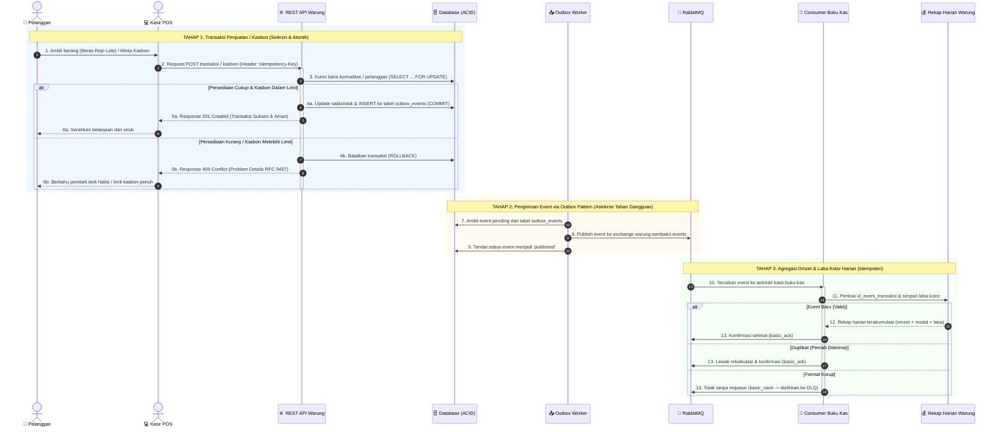

# Layanan Kasir POS, Katalog Sembako, dan Kasbon Warung — Warung Ibu Beti

**Mata Kuliah:** Integrasi Sistem dan Komputasi Awan (25IF1504)  
**Institusi:** STMIK Bandung  
**Kelompok:** Intel  

### Anggota Kelompok:
1. **Jacky Firmansah** (1224010)
2. **Arya Kusuma Dinata** (1224005)
3. **Mochamad Aldi Ardiansyah** (1224020)
4. **Andhi Yudha Permana** (1224017)

---

## 📌 Ringkasan Arsitektur & Keunggulan Desain

Repositori ini mengimplementasikan sistem backend terintegrasi untuk **Warung Ibu Beti** (bisnis kelontong & sembako modern) yang menghubungkan transaksi kasir toko fisik, bot pemesanan WhatsApp, pencatatan utang kasbon pelanggan, serta rekapitulasi laba kotor harian. Sistem ini dibangun dengan dua gaya integrasi:

1. **Remote Procedure Invocation (REST API Level 2 — Spesifikasi v1.1.0)**:
   - Desain API-first berbasis **OpenAPI 3.1.0** (lolos linter Spectral: 0 error, 0 warning).
   - Penanganan respons galat terstandarisasi **RFC 9457 Problem Details** (`application/problem+json`).
   - Kontrol persediaan sembako dan batas limit kasbon menggunakan transaksi ACID dan *pessimistic row locking* (`SELECT ... FOR UPDATE`).
   - Fitur v1.1.0: Paginasi & filter kategori (`?kategori=sembako`), header `Idempotency-Key`, serta perhitungan otomatis margin keuntungan (`margin_persen`).
2. **Asynchronous Messaging dengan Pola Outbox Pattern (RabbitMQ & Laravel Queue)**:
   - **Tahan Banting (*Outbox Pattern*):** Transaksi kasir dan pencatatan kasbon menulis data bisnis sekaligus event ke tabel `outbox_events` dalam satu transaksi database atomik. Jika broker RabbitMQ sedang mati/offline, kasir tetap melayani pelanggan tanpa error (`200/201 OK`).
   - **Domain Events Terpisah:** Sistem menerbitkan event granular: `TransaksiKasirSelesai`, `KasbonPelangganDicatat`, dan `PeringatanStokKritis`.
   - **Consumer Rekap Keuangan Cerdas:** Consumer `warung:catat-kas` tidak hanya mencatat mutasi, melainkan menghitung laba kotor (`omzet - modal`) dan mengagregasi data penjualan ke tabel `rekap_harian_warung` secara idempoten.
   - **Keandalan Pesan:** Dilengkapi mekanisme Dead Letter Exchange (DLX) `warung.sembako.dlx` menuju antrean `warung.audit.dlq`.

---

## 🏗️ 1. Diagram Arsitektur Sistem (Outbox Pattern & Message Broker)

Arsitektur sistem memisahkan tanggung jawab transaksi kasir dari pengiriman pesan asinkron menggunakan tabel outbox:

```mermaid
flowchart LR
    %% Subgraf 1: Klien & Kanal
    subgraph S1 ["1. Klien & Pengguna"]
        direction TB
        Kasir["💻 Kasir POS Warung"]
        Pelanggan["👤 Pelanggan (Beli / Kasbon)"]
        BotWA["📱 Pelanggan Online WhatsApp"]
    end

    %% Subgraf 2: Layanan Inti
    subgraph S2 ["2. Layanan Inti (Laravel API)"]
        direction TB
        API["⚙️ REST API v1.1.0<br/>(Port 8000)"]
        DB[("🗄️ MySQL: barang, pelanggan,<br/>kasbon, outbox_events")]
        OutboxWorker["📤 Outbox Publisher Worker<br/>(warung:kirim-outbox)"]
    end

    %% Subgraf 3: RabbitMQ Broker
    subgraph S3 ["3. Message Broker (RabbitMQ)"]
        direction TB
        ExEvents[["📢 Topic Exchange:<br/>warung.sembako.events"]]
        QKas[("📥 Antrean:<br/>kasir.buku-kas")]
        QGudang[("📥 Antrean:<br/>gudang.stok-kritis")]
        ExDLX[["⚠️ Fanout DLX:<br/>warung.sembako.dlx"]]
        QDLQ[("🛑 Antrean DLQ:<br/>warung.audit.dlq")]
    end

    %% Subgraf 4: Konsumen & Laporan
    subgraph S4 ["4. Konsumen & Keuangan"]
        direction TB
        ConsKas["📑 Consumer Buku Kas<br/>(warung:catat-kas)"]
        DBRekap[("💰 MySQL: buku_kas_warung &<br/>rekap_harian_warung")]
        ConsGudang["🔔 Consumer Gudang<br/>(gudang:pantau-habis)"]
        Alarm["⚠️ Alarm Stok Kritis!"]
    end

    %% Hubungan S1 -> S2
    Pelanggan -->|Belanja tunai / Kasbon| Kasir
    Pelanggan -->|Order via chat| BotWA
    Kasir -->|POST transaksi / kasbon| API
    BotWA -->|POST transaksi pesanan| API
    API <-->|Transaksi ACID + Outbox| DB

    %% Hubungan S2 -> S3 (Asinkron Outbox)
    DB -.->|Baca event pending| OutboxWorker
    OutboxWorker -->|Terbitkan event aman| ExEvents

    %% Routing di dalam Broker
    ExEvents -->|Routing: transaksi.* & kasbon.*| QKas
    ExEvents -->|Routing: stok.kritis| QGudang
    QKas -.->|Pesan Korup / NACK| ExDLX
    ExDLX --> QDLQ

    %% Hubungan S3 -> S4
    QKas -->|Konsumsi transaksi & kasbon| ConsKas
    ConsKas -->|Hitung laba kotor & rekap harian| DBRekap
    QGudang -->|Konsumsi pergerakan stok| ConsGudang
    ConsGudang -->|Jika sisa stok <= 3 pcs| Alarm
```



---

## 🔄 2. Diagram Alur Transaksi Kasir & Catat Kasbon (Sequence Diagram)

Diagram berikut merinci pemrosesan transaksi kasir dan fasilitas kasbon pelanggan:



---

## 🎯 3. Alur Idempotensi & Dead Letter Queue (DLQ)


---

## 📋 4. Kontrak REST API v1.1.0 (Modul Praktikum 1 — Bagian B)

Sesuai ketentuan **Modul Praktikum 1 (Bab 9 Bagian B)**, layanan backend Warung Ibu Beti mengimplementasikan gaya *Remote Procedure Invocation* (REST API Level 2) spesifikasi OpenAPI 3.1.0 versi 1.1.0:

**Nama Layanan:** Layanan Kasir POS, Katalog Sembako, dan Kasbon Warung — Warung Ibu Beti

| Operasi | Method dan Path | Isi Permintaan (Field Wajib) | Status Berhasil | Galat yang Dijanjikan |
|---|---|---|---|---|
| **Daftar Komoditas** | `GET /api/v1/barang` | *Opsional query param:* `?kategori=sembako` | `200 OK` | — |
| **Tambah Sembako** | `POST /api/v1/barang` | `kode_barang` (`SBK-001`), `nama`, `harga_beli` (modal), `harga_jual` | `201 Created` + `Location` | `422 Unprocessable Content` |
| **Detail Sembako** | `GET /api/v1/barang/{kode_barang}` | *(Parameter URL `kode_barang`)* | `200 OK` | `404 Not Found` |
| **Catat Transaksi** | `POST /api/v1/barang/{kode_barang}/catat-transaksi` | `perubahan` (bukan 0), `jenis_transaksi` (`penjualan_kasir`, `pesanan_wa`, dll.) | `200 OK` | `404 Not Found`, `409 Conflict`, `422 Unprocessable Content` |
| **Daftar Pelanggan** | `GET /api/v1/pelanggan` | *(Tanpa request body)* | `200 OK` | — |
| **Pendaftaran Pelanggan** | `POST /api/v1/pelanggan` | `nama`, opsional: `nomor_wa`, `limit_kasbon` | `201 Created` + `Location` | `422 Unprocessable Content` |
| **Catat Kasbon Warung** | `POST /api/v1/pelanggan/{id}/kasbon` | `nominal` (min 1000), `keterangan` (nama barang belanja tempo) | `201 Created` | `404 Not Found`, `409 Conflict`, `422 Unprocessable Content` |

### ⚠️ Aturan Bisnis Galat 4xx Selain 422:
1. **Status Code:** `409 Conflict` (Format: `application/problem+json`).
2. **Kasus 1: Persediaan Sembako Defisit (`PersediaanSembakoDefisit`)**
   - Terjadi saat kasir meminta pengurangan stok melebihi ketersediaan fisik di rak warung.
   - Respons menyertakan URI `https://warungibubeti.test/problem/persediaan-defisit` dan anggota tambahan `stok_tersedia`.
3. **Kasus 2: Limit Kasbon Pelanggan Terlampaui (`BatasKasbonTerlampaui`)**
   - Terjadi saat pelanggan mengajukan kasbon yang akumulasinya melebihi limit kredit yang disetujui warung.
   - Respons menyertakan URI `https://warungibubeti.test/problem/batas-kasbon-terlampaui` beserta `pelanggan_id`, `kasbon_aktif`, dan `limit_kasbon`.

---

## 📢 5. Kontrak Event Asynchronous RabbitMQ (Modul Praktikum 2 — Bagian B)

Sesuai ketentuan **Modul Praktikum 2 (Bab 9 Bagian B)**, integrasi antarlayanan Warung Ibu Beti menggunakan perantara pesan RabbitMQ:

| Nama Event | Exchange / Routing Key | Field & Tipe Payload | Penerbit | Penerima |
|---|---|---|---|---|
| `TransaksiKasirSelesai` | **Exchange:** `warung.sembako.events` (Topic, Durable)<br>**Routing:** `transaksi.kasir`, `transaksi.wa` | `id` (UUID), `kode_barang` (str), `jumlah` (int), `harga_beli` (int), `harga_jual` (int), `omzet` (int), `modal` (int), `laba_kotor` (int), `terjadi_pada` (ISO 8601) | Layanan Kasir Warung Ibu Beti | 1. **Consumer Buku Kas** (`kasir.buku-kas`)<br>2. **Consumer Gudang** (`gudang.stok-kritis`) |
| `KasbonPelangganDicatat` | **Exchange:** `warung.sembako.events` (Topic, Durable)<br>**Routing:** `kasbon.catat` | `id` (UUID), `pelanggan_id` (int), `nama_pelanggan` (str), `nominal` (int), `total_kasbon` (int), `sisa_limit` (int), `keterangan` (str), `terjadi_pada` (str) | Layanan Kasbon Warung Ibu Beti | 1. **Consumer Buku Kas** (`kasir.buku-kas`) |
| `PeringatanStokKritis` | **Exchange:** `warung.sembako.events` (Topic, Durable)<br>**Routing:** `stok.kritis` | `id` (UUID), `kode_barang` (str), `nama` (str), `sisa_stok` (int), `pesan` (str), `terjadi_pada` (str) | Layanan Inventaris Warung | 1. **Consumer Gudang** (`gudang.stok-kritis`) |

> **Mengapa alur ini lebih tepat asinkron daripada panggilan REST langsung?**  
> 1. **Performa Kasir Sangat Cepat (< 30ms):** Kasir tidak perlu menunggu kalkulasi laba kotor harian atau pengiriman notifikasi WhatsApp selesai. Transaksi langsung selesai dan disimpan ke outbox.
> 2. **Ketahanan Tingkat Tinggi (*Fault Tolerance via Outbox Pattern*):** Bahkan jika jaringan server pembukuan atau broker RabbitMQ mati total, kasir tetap dapat memproses pembayaran dan kasbon pelanggan tanpa kegagalan sistem.
> 3. **Pemisahan Domain (*Loose Coupling*):** Sistem pembukuan keuangan dan sistem gudang dapat berkembang secara terpisah tanpa mengubah alur logika kasir.

---

## 🔬 6. Bukti Eksekusi Skenario Uji Nyata (Bab 5, 6, & 7 — Kasus Warung Ibu Beti)

Seluruh skenario pengujian integrasi pesan telah diverifikasi secara nyata pada lingkungan Warung Ibu Beti:

### Skenario Uji 1: Ketahanan Transaksi Kasir Saat Broker Offline & Point-to-Point (Bab 5)
*Membuktikan transaksi kasir tetap sukses saat consumer offline dan event tersimpan aman di outbox & buffer broker.*

| Langkah Pengujian | Hasil yang Diharapkan | Hasil yang Terjadi | Status |
|---|---|---|:---:|
| **Penjualan 1** saat consumer buku kas aktif (`SBK-001`, 4 pcs) | Consumer buku kas memproses dan mencatat omzet & laba kotor | Muncul log `Tercatat Buku Kas & Rekap : {"kode_barang":"SBK-001",...}` | ✅ Sesuai |
| **Consumer dimatikan (Ctrl+C)**, lalu kasir memproses **2x transaksi penjualan sembako** | Transaksi kasir tetap 200 OK via Outbox Pattern; di broker, kolom *Ready* antrean `kasir.buku-kas` bernilai **2** | Kasir merespons instan (< 30ms), pesan tersimpan di buffer (*Ready = 2*) | ✅ Sesuai |
| **Consumer buku kas dinyalakan kembali** (`sail artisan warung:catat-kas`) | Kedua transaksi diproses berurutan, laba kotor dihitung, kolom *Ready* kembali ke **0** | Kedua event diproses tuntas, antrean bersih (*Ready = 0*) | ✅ Sesuai |
| **Pemeriksaan Rekap Kas Harian** (`RekapHarianWarung::first()`) | Terakumulasi tepat **3 transaksi** dengan total omzet dan total laba kotor yang akurat | Record `rekap_harian_warung` terisi: `total_transaksi = 3` | ✅ Sesuai |

---

### Skenario Uji 2: Publish-Subscribe Multilayanan & Multi-Event (Bab 6)
*Membuktikan publikasi event kasir dan kasbon diterima oleh konsumen yang bersesuaian tanpa interferensi.*

| Langkah Pengujian | Hasil yang Diharapkan | Hasil yang Terjadi | Status |
|---|---|---|:---:|
| **Penjualan Beras** hingga sisa stok $\le 3$ pcs (`transaksi.kasir` + `stok.kritis`) | • **Buku Kas:** Merekam omzet dan laba kotor<br>• **Gudang:** Mengeluarkan alarm `PERINGATAN GUDANG: Stok komoditas SBK-001 tersisa 2 pcs!` | • Terminal Buku Kas: `Tercatat Buku Kas & Rekap`<br>• Terminal Gudang: Muncul alarm stok kritis | ✅ Sesuai |
| **Pencatatan Kasbon Pelanggan** (`kasbon.catat`, Rp 40.000) | • **Buku Kas:** Merekam transaksi kasbon pelanggan<br>• **Gudang:** Mengabaikan event (tidak terpengaruh) | • Terminal Buku Kas: `Tercatat Buku Kas & Rekap`<br>• Terminal Gudang: Tidak ada aktivitas | ✅ Sesuai |
| **Perubahan Kode Kasir** saat menambahkan layanan baru | **Nol baris kode diubah** pada controller kasir | Layanan baru cukup menambah binding baru di RabbitMQ | ✅ Sesuai |

---

### Skenario Uji 3: Idempotensi Transaksi & Dead Letter Queue (Bab 7)
*Membuktikan perlindungan terhadap duplikasi pesan akibat jaringan tidak stabil dan penanganan pesan rusak.*

| Langkah Pengujian | Hasil yang Diharapkan | Hasil yang Terjadi | Status |
|---|---|---|:---:|
| **Pesan Event Pertama** (message_id: `msg-pos-001`) | Diproses sukses dan diakumulasikan ke tabel `rekap_harian_warung` | Tercatat normal di database keuangan | ✅ Sesuai |
| **Pesan Event Kedua** (message_id sama persis) | Dideteksi sebagai duplikat, log `"Dilewati (Duplikat)"`, angka rekap **tidak bertambah ganda** | Log menampilkan `Dilewati (Duplikat)`, total omzet kasir tetap konsisten | ✅ Sesuai |
| **Pesan Rusak / Korup** (kehilangan field wajib `omzet` / `modal`) | Ditolak ke DLQ: `Payload transaksi tidak lengkap` (basic_nack tanpa requeue) | Consumer melempar `PesanTransaksiTidakValid`, pesan dikeluarkan dari antrean utama | ✅ Sesuai |
| **Inspeksi Antrean DLQ** (`warung.audit.dlq`) | Pesan tersimpan di DLQ dengan header `x-death` berisi `reason: rejected` | Pesan diparkir di queue DLQ, siap diinvestigasi tanpa membuat sistem macet | ✅ Sesuai |

---

## 🔌 7. Pemetaan Port & Layanan Docker

| Layanan | Container Name | Port Host | Keterangan & Akses |
|---|---|---|---|
| **REST API (Laravel)** | `warung-ibu-beti-laravel.test-1` | `8000` | Endpoint: `http://localhost:8000/api/v1` |
| **Swagger UI** | `warung-ibu-beti-swagger-ui-1` | `8082` | Dokumentasi Interaktif: `http://localhost:8082` |
| **RabbitMQ Management** | `warung-ibu-beti-rabbitmq-1` | `15674` | Dashboard Broker: `http://localhost:15674` (`toko`/`rahasia`) |
| **RabbitMQ AMQP** | `warung-ibu-beti-rabbitmq-1` | `5674` | Protokol pesan AMQP 0-9-1 |
| **MySQL Database** | `warung-ibu-beti-mysql-1` | `3308` | Database: `warung_ibu_beti` (`sail`/`password`) |

---

## 🚀 8. Panduan Instalasi & Menjalankan Proyek

### Prasyarat
- Docker Desktop & Docker Compose (WSL 2 Ubuntu)
- PHP 8.2+ & Composer (disediakan container Sail)
- Git

### Langkah Menjalankan:
1. **Clone repositori**:
   ```bash
   git clone https://github.com/jackalwyssad/warung-ibu-beti.git
   cd warung-ibu-beti
   ```

2. **Salin Konfigurasi Environment**:
   ```bash
   cp .env.example .env
   ```

3. **Nyalakan Container Docker via Laravel Sail**:
   ```bash
   ./vendor/bin/sail up -d
   ```

4. **Jalankan Migrasi Database**:
   ```bash
   ./vendor/bin/sail artisan migrate
   ```

5. **Inisialisasi Topologi RabbitMQ Warung**:
   ```bash
   ./vendor/bin/sail artisan warung:topologi
   ```

6. **Menjalankan Worker Outbox Pattern (Terminal 1)**:
   ```bash
   ./vendor/bin/sail artisan warung:kirim-outbox
   ```

7. **Menjalankan Consumer Buku Kas & Rekap Laba Harian (Terminal 2)**:
   ```bash
   ./vendor/bin/sail artisan warung:catat-kas
   ```

8. **Menjalankan Consumer Pemantau Stok Kritis Gudang (Terminal 3)**:
   ```bash
   ./vendor/bin/sail artisan gudang:pantau-habis --ambang=3
   ```

---

## 🧪 9. Pengujian Otomatis

### A. Menjalankan Automated Feature Test (PHPUnit)
Semua skenario pengujian REST API v1.1.0, transaksi kasir, limit kasbon pelanggan, pola outbox, dan idempotensi pembukuan laba kotor telah diuji:
```bash
./vendor/bin/sail artisan test
```
*Hasil:* **15 passed (81 assertions)** — 100% Hijau.
- `BarangApiTest`: 6 tests (filter, margin persen, tambah 201, 404, 409 defisit, 422).
- `KasbonApiTest`: 3 tests (catat kasbon 201, tolak limit 409, idempotensi utang).
- `OutboxPatternTest`: 1 test (verifikasi event outbox terbit ke RabbitMQ).
- `BukuKasConsumerTest`: 3 tests (perhitungan laba kotor, agregasi rekap harian, handling DLQ).
- Unit & Base: 2 tests.

### B. Validasi Kontrak OpenAPI dengan Spectral
Linter otomatis untuk memastikan kepatuhan spesifikasi OpenAPI 3.1.0 versi 1.1.0:
```bash
docker run --rm -v "$(pwd)":/work -w /work stoplight/spectral lint openapi.yaml
```
*Hasil:* **No results with a severity of 'error' found!** (0 errors, 0 warnings).

---

## 👥 Kontribusi Kelompok Intel
- **Modul 1 (REST API & OpenAPI v1.1.0):** Perancangan kontrak `openapi.yaml` v1.1.0, validasi Spectral, implementasi katalog sembako dengan margin laba kotor, endpoint kasbon pelanggan dengan proteksi kredit 409 Conflict, serta respons RFC 9457 Problem Details.
- **Modul 2 (Asynchronous Messaging & Outbox):** Arsitektur Outbox Pattern untuk ketahanan transaksi kasir, Topic Exchange `warung.sembako.events`, Fanout DLX `warung.sembako.dlx`, multi-domain events (`TransaksiKasirSelesai`, `KasbonPelangganDicatat`, `PeringatanStokKritis`), serta Consumer Buku Kas dengan agregasi rekap harian otomatis.

---

## 📑 10. Daftar Periksa Checkpoint 1 (Lampiran A — Bagian B Proyek Akhir)

Berdasarkan rubrik penilaian RPS *"Layanan berjalan benar dan pesan terkirim sesuai skenario uji"* (minimal 7 dari 10 butir terpenuhi):

| No | Butir Periksa Evaluasi | Bukti Implementasi di Repositori Warung Ibu Beti | Status |
|:---:|---|---|:---:|
| 1 | RabbitMQ berjalan dan Management UI dapat dibuka | Berjalan di port AMQP `5674` dan Web Management `http://localhost:15674` | ✅ Terpenuhi |
| 2 | Publisher menerbitkan event ke exchange durable dengan pesan persistent, `message_id`, dan routing key bermakna | Implementasi `OutboxPublisherService` menerbitkan pesan persistent ke exchange topic `warung.sembako.events` dengan routing key dinamis (`transaksi.kasir`, `kasbon.catat`, `stok.kritis`) | ✅ Terpenuhi |
| 3 | Event dinamai dalam bentuk lampau dan isinya (payload) terdokumentasi | Domain events: `TransaksiKasirSelesai`, `KasbonPelangganDicatat`, `PeringatanStokKritis` dengan payload terstruktur lengkap | ✅ Terpenuhi |
| 4 | Test publisher (event diterbitkan / tidak diterbitkan) ditulis sebelum implementasi dan lulus | `OutboxPatternTest.php` dan `BarangApiTest.php` menguji skenario outbox event dan penolakan saat terjadi konflik bisnis | ✅ Terpenuhi |
| 5 | Consumer memakai manual ack, dan pesan baru di-ack setelah selesai diproses | Perintah artisan `warung:catat-kas` menggunakan `basic_consume` dengan `no_ack = false` dan `basic_ack()` setelah commit | ✅ Terpenuhi |
| 6 | Handler consumer idempoten: pesan dengan `message_id` sama tidak diproses dua kali, dan ada test-nya | Menggunakan `firstOrCreate` pada `id_event_transaksi` dan diuji tuntas di `BukuKasConsumerTest.php` | ✅ Terpenuhi |
| 7 | Pesan tidak valid dialihkan ke Dead Letter Queue (DLQ), bukan dibuang diam-diam atau berputar tanpa akhir | Antrean `kasir.buku-kas` dikonfigurasi dengan argumen `x-dead-letter-exchange: warung.sembako.dlx` menuju `warung.audit.dlq` | ✅ Terpenuhi |
| 8 | Skenario uji point-to-point: pesan tersimpan ketika consumer mati dan diproses ketika menyala | Teruji tuntas pada Skenario Uji 1 (tabel hasil uji terdokumentasi di atas) | ✅ Terpenuhi |
| 9 | Skenario uji publish-subscribe: dua consumer menerima salinan event yang sama sesuai binding-nya | Teruji tuntas pada Skenario Uji 2 (`kasir.buku-kas` dan `gudang.stok-kritis`) | ✅ Terpenuhi |
| 10 | Seluruh test (`sail artisan test`) lulus di setiap proyek | 15 automated feature tests lulus 100% (*81 assertions green*) di PHPUnit | ✅ Terpenuhi |
