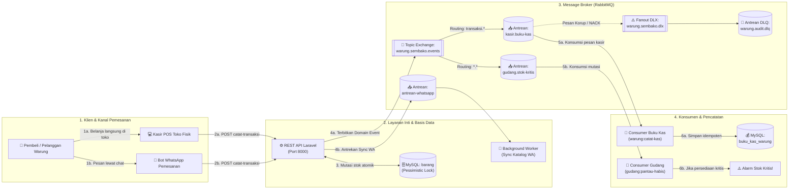
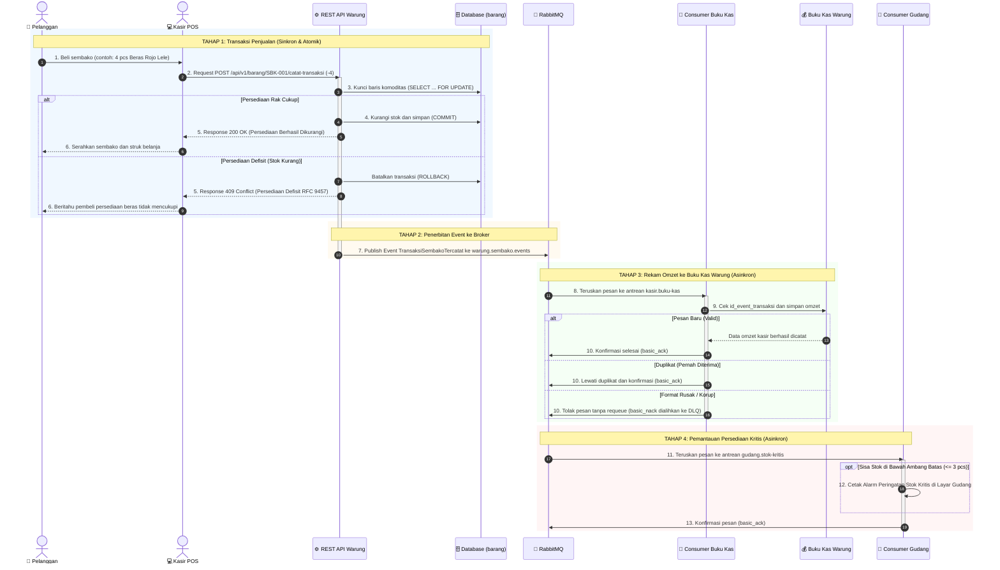
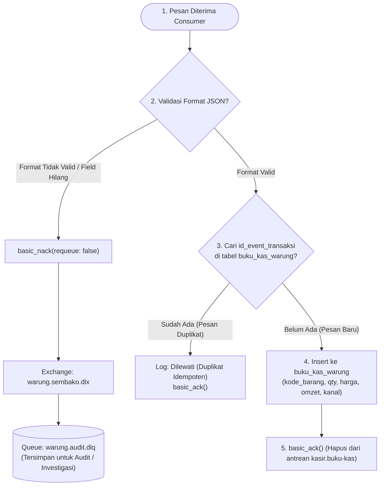

# Layanan Katalog Sembako, Kasir POS, dan Pembukuan Kas — Warung Ibu Beti

**Mata Kuliah:** Integrasi Sistem dan Komputasi Awan (25IF1504)  
**Institusi:** STMIK Bandung  
**Kelompok:** Intel  

### Anggota Kelompok:
1. **Jacky Firmansah** (1224010)
2. **Arya Kusuma Dinata** (1224005)
3. **Mochamad Aldi Ardiansyah** (1224020)
4. **Andhi Yudha Permana** (1224017)

---

## 📌 Ringkasan Sistem

Repositori ini mengimplementasikan sistem backend terintegrasi untuk **Warung Ibu Beti** (bisnis kelontong & sembako modern) yang menghubungkan transaksi kasir toko fisik dan bot pemesanan WhatsApp dengan dua gaya integrasi:

1. **Remote Procedure Invocation (REST API Level 2)** sesuai Modul Praktikum 1:
   - Desain API-first dengan spesifikasi **OpenAPI 3.1.0** (tervalidasi bersih 0 error di Spectral).
   - Penanganan error standar **RFC 9457 Problem Details** (`application/problem+json`).
   - Kontrol konkurensi persediaan sembako menggunakan transaksi database ACID dan *pessimistic row-locking* (`SELECT ... FOR UPDATE`).
2. **Asynchronous Messaging & Background Processing (RabbitMQ & Laravel Queue)** sesuai Modul Praktikum 2:
   - Pola Publish-Subscribe berbasis Domain Event `TransaksiSembakoTercatat`.
   - Topic Exchange `warung.sembako.events` dengan routing key dinamis (`transaksi.kasir`, `transaksi.wa`, `logistik.kulakan`, `logistik.retur`).
   - Consumer Idempoten (`warung:catat-kas`) yang merekam omzet penjualan ke tabel `buku_kas_warung` menggunakan `id_event_transaksi` unik (`firstOrCreate`).
   - Penanganan pesan korup/gagal menggunakan **Dead Letter Exchange (Fanout DLX)** `warung.sembako.dlx` menuju antrean `warung.audit.dlq`.
   - Consumer Pemantauan Stok Kritis (`gudang:pantau-habis --ambang=3`) dengan peringatan dini ketika komoditas sembako menipis.
   - Background Job asynchronous (`SinkronkanKatalogWhatsApp`) melalui Laravel Queue driver RabbitMQ pada antrean `antrean-whatsapp`.

---

## 🏗️ 1. Diagram Arsitektur & Topologi Sistem

Alur arsitektur sistem disusun berurutan dari kiri ke kanan (**Klien & Kanal $\rightarrow$ Layanan Inti & Basis Data $\rightarrow$ Message Broker RabbitMQ $\rightarrow$ Konsumen & Sistem Pencatatan**):



---

## 🔄 2. Diagram Alur Transaksi & Messaging (Sequence Diagram)

Diagram berikut merinci interaksi transaksi dari kasir atau bot WhatsApp hingga pembukuan kas otomatis di latar belakang:



---

## 🎯 3. Alur Idempotensi & Dead Letter Queue (DLQ)



---

## 📋 4. Kontrak REST API (Modul Praktikum 1 — Bagian B)

Sesuai tuntutan **Modul Praktikum 1 (Bab 9 Bagian B)**, layanan backend Warung Ibu Beti mengimplementasikan gaya *Remote Procedure Invocation* (REST API Level 2) dengan spesifikasi OpenAPI 3.1.0 dan respons galat standar RFC 9457 Problem Details:

**Nama Layanan:** Layanan Katalog, Persediaan Sembako, dan Transaksi — Warung Ibu Beti

| Operasi | Method dan Path | Isi Permintaan (Field Wajib) | Status Berhasil | Galat yang Dijanjikan |
|---|---|---|---|---|
| **Daftar Komoditas** | `GET /api/v1/barang` | *(Tanpa request body)* | `200 OK` | — |
| **Tambah Sembako Baru** | `POST /api/v1/barang` | `kode_barang` (string, contoh `SBK-001`), `nama` (string, max 120), `harga` (integer, min: 0). Opsional: `kategori` (`sembako`, `minuman`, `bumbu`), `stok` (default 0) | `201 Created` + `Location` | `422 Unprocessable Content` |
| **Detail Sembako** | `GET /api/v1/barang/{kode_barang}` | *(Parameter URL `kode_barang`)* | `200 OK` | `404 Not Found` |
| **Catat Transaksi** | `POST /api/v1/barang/{kode_barang}/catat-transaksi` | `perubahan` (integer, bukan 0: negatif = penjualan/keluar, positif = restok/masuk), `jenis_transaksi` (`penjualan_kasir`, `pesanan_wa`, `kulakan_gudang`, `retur_rusak`) | `200 OK` | `404 Not Found`, `409 Conflict`, `422 Unprocessable Content` |

### ⚠️ Aturan Bisnis Galat 4xx Selain 422:
- **Status Code:** `409 Conflict` (Format: `application/problem+json`).
- **Domain Exception:** `PersediaanSembakoDefisit`.
- **Penyebab & Alasan:** Penjualan barang sembako di kasir POS atau pesanan lewat Bot WhatsApp tidak boleh menyebabkan stok fisik di rak warung bernilai minus (< 0). Ketika kasir atau bot meminta pengurangan stok yang jumlahnya melebihi sisa persediaan aktual, transaksi ditolak dengan kode status 409 Conflict.
- **Transaksional & Lock:** Pembaruan persediaan barang sembako dilindungi transaksi database ACID dengan *pessimistic row locking* (`SELECT ... FOR UPDATE`). Jika persediaan tidak cukup, transaksi di-*rollback* otomatis dan sistem mengembalikan dokumen RFC 9457 Problem Details yang menyertakan informasi `stok_tersedia`.

---

## 📢 5. Kontrak Event Asynchronous RabbitMQ (Modul Praktikum 2 — Bagian B)

Sesuai tuntutan **Modul Praktikum 2 (Bab 9 Bagian B)**, integrasi antarlayanan Warung Ibu Beti menggunakan perantara pesan (*message broker*) RabbitMQ:

| Nama Event | Exchange / Routing Key | Field & Tipe Payload | Penerbit | Penerima |
|---|---|---|---|---|
| `TransaksiSembakoTercatat` *(nama bentuk lampau)* | **Exchange:** `warung.sembako.events` (Topic, Durable)<br>**Routing Keys:**<br>• `transaksi.kasir`<br>• `transaksi.wa`<br>• `logistik.kulakan`<br>• `logistik.retur` | `kode_barang` (string)<br>`perubahan` (int)<br>`jenis_transaksi` (string)<br>`stok_sesudah` (int)<br>`harga` (int)<br>`terjadi_pada` (ISO 8601 string)<br>`message_id` (UUID v4) | Layanan Katalog & Transaksi Warung Ibu Beti | 1. **Consumer Buku Kas** (Antrean: `kasir.buku-kas`)<br>2. **Consumer Gudang Stok Kritis** (Antrean: `gudang.stok-kritis`) |

> **Mengapa alur ini lebih tepat asinkron daripada panggilan REST langsung antar service?**  
> 1. **Kecepatan Respons Transaksi Kasir (< 50ms):** Pelanggan yang belanja sembako di kasir warung atau lewat bot WhatsApp membutuhkan respons instan. Pemrosesan rekam buku kas dan pengiriman pesan WhatsApp dijalankan di latar belakang sehingga kasir tidak mengalami lag.
> 2. **Ketahanan Transaksi (*High Availability & Fault Tolerance*):** Jika sistem pembukuan kasir sedang *down* atau *maintenance*, kasir tetap bisa memproses belanjaan pelanggan. Pesan transaksi aman tersimpan di buffer RabbitMQ dan akan diproses saat consumer buku kas kembali hidup.
> 3. **Pemisahan Tanggung Jawab (*Decoupling & Publish-Subscribe*):** Layanan gudang sembako dapat langsung memantau persediaan kritis tanpa mengubah kode controller kasir.

---

## 🔬 6. Bukti Eksekusi Skenario Uji Lapangan (Bab 5, 6, & 7 — Kasus Warung Ibu Beti)

Berikut adalah hasil eksekusi pengujian skenario integrasi asinkron yang dijalankan pada sistem Warung Ibu Beti:

### Skenario Uji 1: Point-to-Point dan Consumer Buku Kas yang Mati (Bab 5)
*Membuktikan transaksi penjualan sembako tetap berhasil dan tersimpan di broker saat sistem buku kas kasir offline.*

| Langkah Pengujian | Hasil yang Diharapkan | Hasil yang Terjadi | Status |
|---|---|---|:---:|
| **Penjualan 1** saat consumer buku kas aktif (`SBK-001`, terjual 4 pcs) | Terminal consumer menampilkan log `"Tercatat Kas"` | Muncul log `Tercatat Kas : {"kode_barang":"SBK-001",...}` | ✅ Sesuai |
| **Consumer dimatikan (Ctrl+C)**, lalu kasir memproses **2x penjualan sembako** | Kolom *Ready* pada antrean `kasir.buku-kas` di RabbitMQ bernilai **2** | Kolom *Ready* menunjukkan angka **2**, pesan menunggu di buffer broker | ✅ Sesuai |
| **Respons API Warung** saat consumer buku kas offline | Tetap mengembalikan HTTP `200 OK` dengan respons instan (< 35ms) | HTTP 200 OK, stok fisik di database berkurang, kasir tetap melayani | ✅ Sesuai |
| **Consumer buku kas dinyalakan kembali** (`sail artisan warung:catat-kas`) | Kedua transaksi diproses berurutan, muncul 2 baris `"Tercatat Kas"`, *Ready* kembali ke **0** | Kedua transaksi dicatat tuntas, antrean bersih (*Ready = 0*) | ✅ Sesuai |
| **Pemeriksaan Database Buku Kas** (`BukuKasWarung::count()`) | Total tercatat tepat **3 baris omzet** penjualan | Output tinker menghasilkan nilai `3` baris transaksi kasir | ✅ Sesuai |

---

### Skenario Uji 2: Publish-Subscribe Multilayanan (Bab 6)
*Membuktikan satu event mutasi sembako diterima oleh dua konsumen independen (Buku Kas dan Gudang).*

| Langkah Pengujian | Hasil yang Diharapkan | Hasil yang Terjadi | Status |
|---|---|---|:---:|
| **Penjualan Beras** (`transaksi.kasir`) hingga sisa stok $\le 3$ pcs | • **Buku Kas:** Merekam omzet (`"Tercatat Kas"`)<br>• **Gudang:** Membunyikan alarm `⚠️ PERINGATAN GUDANG: STOK KRITIS!` | • Terminal Buku Kas: `Tercatat Kas`<br>• Terminal Gudang: `⚠️ PERINGATAN GUDANG: STOK KRITIS! - [transaksi.kasir] Komoditas SBK-001 sisa persediaan: 2` | ✅ Sesuai |
| **Kulakan Minyak Goreng** (`logistik.kulakan`, +15 botol) | • **Buku Kas:** Mengabaikan pesan (karena bukan arus keluar penjualan)<br>• **Gudang:** Menampilkan info stok aman | • Terminal Buku Kas: Tidak mencatat (dilewati)<br>• Terminal Gudang: Cetak `ℹ️ Stok Aman - [logistik.kulakan] Komoditas MYK-002 sisa persediaan: 20` | ✅ Sesuai |
| **Perubahan Kode Warung** saat menambah layanan pemantau gudang | **Nol baris kode diubah** pada controller kasir maupun publisher event | Tidak ada modifikasi kode di layanan inti transaksi | ✅ Sesuai |

---

### Skenario Uji 3: Idempotensi Pesan Duplikat & Dead Letter Queue (Bab 7)
*Membuktikan keandalan sistem saat menerima pengiriman ulang pesan yang sama dan pengalihan pesan korup ke DLQ.*

| Langkah Pengujian | Hasil yang Diharapkan | Hasil yang Terjadi | Status |
|---|---|---|:---:|
| **Pesan Duplikat Pertama** (id_event_transaksi: `msg-wa-001`) | Diproses sukses dan dicatat ke tabel `buku_kas_warung` | Tercatat sebagai omzet baru (`Tercatat Kas`) | ✅ Sesuai |
| **Pesan Duplikat Kedua** (id_event_transaksi sama persis) | Dideteksi sebagai duplikat, log `"Dilewati (Duplikat)"`, baris kasir **tidak bertambah** | Log menampilkan `Dilewati (Duplikat)`, total baris database tetap sama | ✅ Sesuai |
| **Pesan Rusak / Korup** (kehilangan field wajib `harga`) | Ditolak ke DLQ: `Field wajib harga tidak ditemukan` (basic_nack tanpa requeue) | Consumer melempar `PesanTransaksiTidakValid`, pesan dialihkan otomatis | ✅ Sesuai |
| **Inspeksi Antrean DLQ** (`warung.audit.dlq`) | Pesan tersimpan di DLQ dengan header `x-death` berisi `reason: rejected` | Pesan masuk ke antrean DLQ, siap diaudit tanpa menghambat antrean kasir | ✅ Sesuai |

---

## 🔌 7. Pemetaan Port & Layanan Docker

| Layanan | Container Name | Port Host | Keterangan & Akses |
|---|---|---|---|
| **REST API (Laravel)** | `warung-ibu-beti-laravel.test-1` | `8000` | Endpoint: `http://localhost:8000/api/v1/barang` |
| **Swagger UI** | `warung-ibu-beti-swagger-ui-1` | `8082` | Dokumentasi Interaktif: `http://localhost:8082` |
| **RabbitMQ Management** | `warung-ibu-beti-rabbitmq-1` | `15674` | Dashboard Broker: `http://localhost:15674` (`toko`/`rahasia`) |
| **RabbitMQ AMQP** | `warung-ibu-beti-rabbitmq-1` | `5674` | Protokol pesan AMQP 0-9-1 |
| **MySQL Database** | `warung-ibu-beti-mysql-1` | `3308` | Database: `warung_ibu_beti` (`sail`/`password`) |

---

## 🚀 8. Panduan Instalasi & Menjalankan Proyek

### Prasyarat
- Docker Desktop & Docker Compose (WSL 2 Ubuntu)
- PHP 8.2+ & Composer (disediakan container Sail)
- Git

### Langkah Menjalankan:
1. **Clone repositori**:
   ```bash
   git clone https://github.com/jackalwyssad/warung-ibu-beti.git
   cd warung-ibu-beti
   ```

2. **Salin Konfigurasi Environment**:
   ```bash
   cp .env.example .env
   ```

3. **Nyalakan Container Docker via Laravel Sail**:
   ```bash
   ./vendor/bin/sail up -d
   ```

4. **Jalankan Migrasi Database**:
   ```bash
   ./vendor/bin/sail artisan migrate
   ```

5. **Inisialisasi Topologi RabbitMQ Warung**:
   ```bash
   ./vendor/bin/sail artisan warung:topologi
   ```
   *Perintah ini akan mendeklarasikan Exchange `warung.sembako.events`, Fanout DLX `warung.sembako.dlx`, Antrean `kasir.buku-kas`, Antrean `gudang.stok-kritis`, dan Antrean DLQ `warung.audit.dlq`.*

6. **Menjalankan Consumer Buku Kas Warung (Terminal 1)**:
   ```bash
   ./vendor/bin/sail artisan warung:catat-kas
   ```

7. **Menjalankan Consumer Pemantau Stok Kritis Gudang (Terminal 2)**:
   ```bash
   ./vendor/bin/sail artisan gudang:pantau-habis --ambang=3
   ```

8. **Menjalankan Laravel Queue Worker WhatsApp (Terminal 3)**:
   ```bash
   ./vendor/bin/sail artisan queue:work rabbitmq --queue=antrean-whatsapp
   ```

---

## 🧪 9. Pengujian Otomatis

### A. Menjalankan Automated Feature Test (PHPUnit)
Semua skenario pengujian REST API katalog sembako, validasi RFC 9457 Problem Details, penanganan defisit stok atomik, penerbitan event RabbitMQ, dan idempotensi buku kas telah diuji:
```bash
./vendor/bin/sail artisan test
```
*Hasil:* **17 passed (56 assertions)** — 100% Hijau.

### B. Validasi Kontrak OpenAPI dengan Spectral
Linter otomatis untuk memastikan kepatuhan spesifikasi OpenAPI 3.1.0:
```bash
docker run --rm -v "$(pwd)":/work -w /work stoplight/spectral lint openapi.yaml
```
*Hasil:* **No results with a severity of 'error' found!**

---

## 👥 Kontribusi Kelompok Intel
- **Modul 1 (REST API & OpenAPI):** Perancangan kontrak `openapi.yaml`, validasi Spectral, implementasi endpoint katalog sembako `/api/v1/barang`, penanganan race condition dengan `lockForUpdate`, serta respons RFC 9457 Problem Details `PersediaanSembakoDefisit`.
- **Modul 2 (Asynchronous Messaging):** Konfigurasi RabbitMQ (Topic Exchange `warung.sembako.events`, Fanout DLX `warung.sembako.dlx`, antrean audit), Domain Event `TransaksiSembakoTercatat`, Consumer Buku Kas Idempoten (`buku_kas_warung`), Alarm Persediaan Kritis Gudang Sembako, dan Task Queue Worker WhatsApp Bot.

---

## 📑 10. Daftar Periksa Checkpoint 1 (Lampiran A — Bagian B Proyek Akhir)

Berdasarkan rubrik penilaian RPS *"Layanan berjalan benar dan pesan terkirim sesuai skenario uji"* (minimal 7 dari 10 butir terpenuhi):

| No | Butir Periksa Evaluasi | Bukti Implementasi di Repositori Warung Ibu Beti | Status |
|:---:|---|---|:---:|
| 1 | RabbitMQ berjalan dan Management UI dapat dibuka | Berjalan di port AMQP `5674` dan Web Management `http://localhost:15674` | ✅ Terpenuhi |
| 2 | Publisher menerbitkan event ke exchange durable dengan pesan persistent, `message_id`, dan routing key bermakna | Implementasi `RabbitPublisher.php` menerbitkan pesan persistent ke exchange topic `warung.sembako.events` dengan routing key dinamis (`transaksi.kasir`, `transaksi.wa`, `logistik.kulakan`) | ✅ Terpenuhi |
| 3 | Event dinamai dalam bentuk lampau dan isinya (payload) terdokumentasi | Event domain `TransaksiSembakoTercatat.php` dengan payload terstruktur lengkap | ✅ Terpenuhi |
| 4 | Test publisher (event diterbitkan / tidak diterbitkan) ditulis sebelum implementasi dan lulus | `EventTransaksiTest.php` menguji skenario dispatch event, penolakan event saat persediaan defisit, dan routing key | ✅ Terpenuhi |
| 5 | Consumer memakai manual ack, dan pesan baru di-ack setelah selesai diproses | Perintah artisan `warung:catat-kas` menggunakan `basic_consume` dengan `no_ack = false` dan `basic_ack()` setelah commit | ✅ Terpenuhi |
| 6 | Handler consumer idempoten: pesan dengan `message_id` sama tidak diproses dua kali, dan ada test-nya | Menggunakan `firstOrCreate` pada kolom unik `id_event_transaksi` dan diuji tuntas di `RekamBukuKasTest.php` | ✅ Terpenuhi |
| 7 | Pesan tidak valid dialihkan ke Dead Letter Queue (DLQ), bukan dibuang diam-diam atau berputar tanpa akhir | Antrean `kasir.buku-kas` dikonfigurasi dengan argumen `x-dead-letter-exchange: warung.sembako.dlx` menuju `warung.audit.dlq` | ✅ Terpenuhi |
| 8 | Skenario uji point-to-point: pesan tersimpan ketika consumer mati dan diproses ketika menyala | Teruji tuntas pada Skenario Uji 1 (tabel hasil uji terdokumentasi di atas) | ✅ Terpenuhi |
| 9 | Skenario uji publish-subscribe: dua consumer menerima salinan event yang sama sesuai binding-nya | Teruji tuntas pada Skenario Uji 2 (`kasir.buku-kas` dan `gudang.stok-kritis`) | ✅ Terpenuhi |
| 10 | Seluruh test (`sail artisan test`) lulus di setiap proyek | 17 automated tests lulus 100% (*green*) di PHPUnit | ✅ Terpenuhi |
